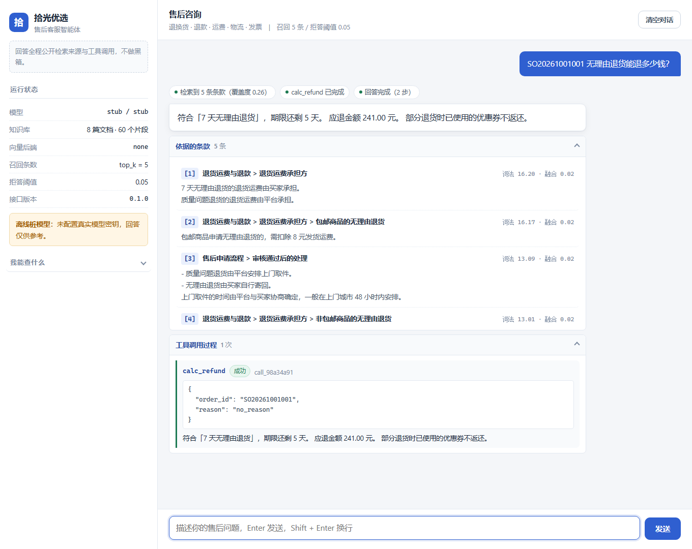

# 拾光优选 · 售后客服智能体

[](https://github.com/sharkbuster/doc-agent/actions/workflows/ci.yml)


一个电商平台的售后客服智能体：收到问题后先去知识库里检索平台政策条款，需要订单数据时调用工具去查，
最后基于**条款原文和工具算出来的数字**生成回答，并标出依据的是哪一条。

**克隆下来不配任何密钥就能跑。** 模型层是可插拔的，默认是一个离线的确定性桩模型，
单元测试、端到端自检、指标评测全都不需要网络和 API key。
（非桩那条路也不是没人管：`tests/test_provider.py` 用 httpx 的传输层拦截，
把 OpenAI 兼容接口真实形状的流式报文喂进去，验证工具 schema 转换、
分片累积、ToolMessage 回灌这些只有接真模型才会走到的代码。）



> 上面是一次真实问答。问题里的订单号触发了 `calc_refund`，退款金额是规则层算出来的，
> 不是模型估的。回答下方是依据的条款原文（带来源路径与得分）和完整的工具调用参数与返回——
> 这个项目刻意把中间过程全摆出来：客服系统出错的时候，你需要知道它到底依据了什么。
>
> 顺序图是「检索到 N 条条款 → 调用了哪个工具 → 回答完成」，每一步都标了状态。

---

## 快速开始

```bash
git clone https://github.com/sharkbuster/doc-agent.git
cd doc-agent

python -m venv .venv
.venv\Scripts\activate            # Linux / macOS: source .venv/bin/activate
pip install -r requirements-dev.txt

python -m pytest -q               # 单元测试
python -m scripts.selfcheck       # 端到端自检
python -m uvicorn app.main:app --reload
```

打开 <http://127.0.0.1:8000> 就是聊天页面。

> 演示订单数据会在首次启动时自动播种（11 个订单，签收时间按「今天」倒推生成）。
> 想刷新日期或者重新造数据，跑 `python -m scripts.seed`。
>
> 想把某个问题连答案一起分享给别人，用 `http://127.0.0.1:8000/?q=你的问题` 打开就会自动提问。

想换成真实模型：把 `.env.example` 复制成 `.env`，改成

```
LLM_PROVIDER=deepseek
DEEPSEEK_API_KEY=sk-xxxxxx
```

DeepSeek 是 OpenAI 兼容接口，不需要额外写适配层。任何 OpenAI 兼容的网关
（官方 API、硅基流动、本地 vLLM）填 `OPENAI_*` 三项也能直接用。

---

## 它能做什么

| 问题类型 | 例子 | 系统怎么处理 |
|---|---|---|
| 政策咨询 | 「7 天无理由退货的期限是几天？」 | 检索条款，带引用回答 |
| 订单数据 | 「SO20261001001 无理由退货能退多少钱？」 | 调 `calc_refund` 算，金额不由模型估 |
| 混合 | 「这个冰箱签收 8 天了还有质量问题，能退吗？」 | 先查订单签收时间，再套大家电 30 天规则 |
| 知识库外 | 「怎么申请提高信用卡额度？」 | 拒答，建议转人工 |

**它不做什么**：不承诺政策之外的东西，不在没有依据时硬编答案，不把别的用户的订单信息说出去。

---

## 架构

```
用户提问
   │
   ├─► 检索       中文感知切分 → 字符 n-gram 哈希向量 + BM25 → RRF 融合 → Top-5 条款
   │
   ├─► 组装提示   条款正文 + 引用编号规则 + 拒答规则（命不中时不塞条款）
   │
   ├─► 模型循环   最多 4 轮
   │      ├─ 模型要求调用工具 → 执行 → 结果回灌 → 继续
   │      └─ 模型给出回答 → 结束
   │
   └─► 引用校验   越界编号直接从回答里抹掉 → 返回回答 + 引用 + 工具轨迹
```

前端把每一步都展示出来：检索到哪几条、相似度多少、调了什么工具、参数是什么、
工具返回了什么。这一层是这个项目刻意做的「白箱」——客服系统出错的时候，
你需要知道它到底依据了什么。

---

## 目录结构

```
app/
  kb/          知识库：切分、分词、向量化、索引、检索
    chunker.py   中文感知切分，保留标题路径做引用
    text.py      分词（全角归一 + 汉字单字 + 英文词 + n-gram）
    embedder.py  字符 n-gram 哈希向量（默认）/ API embeddings（可选）
    index.py     FAISS 索引，装不上时退回 numpy 暴力检索
    retriever.py BM25 + 稠密向量 + RRF 融合 + 拒答判据
  agent/       智能体
    llm.py       模型层：离线桩 / DeepSeek / 任意 OpenAI 兼容网关
    tools.py     六个工具，返回值是 JSON，业务错误不抛异常
    loop.py      多轮循环、步数上限、工具异常回灌、引用校验
    prompts.py   提示词模板
  policy.py    售后规则计算（日期窗口、优惠券分摊、退款金额、赔付）
  store/       订单/物流/库存（SQLite）
  api/         HTTP 接口（含 SSE 流式）
  static/      前端（原生 HTML/CSS/JS，无构建步骤）
data/
  corpus/      知识库语料：8 篇虚构的售后政策文档
  eval/        评测集与评测结果
scripts/
  seed.py      播种演示订单数据
  evaluate.py  跑评测集，输出检索 / 工具选择 / 拒答指标
  selfcheck.py 端到端自检，一条命令确认项目是活的
```

---

## 评测结果

评测集 62 条：政策问答 30、订单数据 18、政策+订单混合 6、超纲 8。全部数字都能用
`python -m scripts.evaluate` 复现（离线桩模型，不需要密钥）。

### 检索：36 条有标准答案的问题

| 检索配置 | 向量后端 | Recall@1 | Recall@3 | Recall@5 | MRR |
|---|---|---|---|---|---|
| 稠密向量（字符 n-gram 哈希） | faiss | 0.444 | 0.722 | 0.778 | 0.588 |
| 混合检索（RRF 等权） | faiss | 0.583 | 0.778 | 0.806 | 0.681 |
| 混合检索（稠密权重 0.0） | faiss | 0.583 | **0.833** | 0.861 | **0.713** |
| **纯词法 BM25（默认配置）** | — | 0.583 | **0.833** | 0.861 | **0.713** |

**结论：我自己实现的向量检索没跑赢 BM25，所以默认没开它。**

不是没试。`scripts/calibrate.py` 扫了两个维度（1024 / 4096）× 三种 n-gram 组合（1-2 / 2-3 / 1-2-3）×
三档融合权重，稠密向量最好的一档是 Recall@3 0.750，仍低于 BM25 的 0.833；
按等权混进 RRF 反而把结果从 0.833 拖到 0.778——弱信号把强信号拽下来了。
（顺带一个反直觉的结果：3-gram 比 2-gram 差很多，0.444，中文 3-gram 太稀疏、哈希碰撞变多。）

原因不难想：这套哈希向量本质上是「字符 n-gram 的词频」，它没有语义泛化能力——
而语义泛化正是学习型嵌入的全部价值。在一份 60 个片段、术语高度特异的领域语料上，
它带来的只有噪声。

所以默认 `RETRIEVAL_MODE=lexical`。向量通路是完整的（切分、向量化、FAISS 索引、RRF 融合、
双后端一致性测试都在），接上真实嵌入模型（`EMBEDDING_BACKEND=api`）之后把模式切回 `hybrid`
并重跑 `scripts/calibrate.py` 定权重即可。

### 拒答判据

| 判据 | 最优阈值 | 误拒答率 | 拒答识别率 | 约登指数 |
|---|---|---|---|---|
| 稠密余弦 | 0.18 | 36.1% | 100% | 0.639 |
| **IDF 加权覆盖度（默认）** | **0.05** | **8.3%** | **100%** | **0.917** |

第一版凭感觉把余弦阈值填成 0.35，结果 36 条政策问题**全部**被判成拒答——
因为余弦的取值范围根本不在 0.35 附近。扫完才发现真正的问题是余弦这个信号本身没有区分度：
该回答的问题落在 0.13~0.33，该拒答的落在 0.11~0.18，几乎完全重叠。

换成「问题里的 bigram 有多少出现在召回的条款里」（按 IDF 加权，取召回前 3 条）之后，
两条错误率才分得开。IDF 加权是必须的：「的」「是」这类字构成的 bigram 到处都是，
不加权的话什么离题问题都能蹭到不错的覆盖度（误拒答 11.1% → 8.3% 就是它带来的）。

剩下 3 条误拒答（P01、P06、P16）都是高度口语化的问法——「我前几天收到的东西，现在不想要了，还能退吗」
这种句子和条款原文的字面重合度本来就低。属于已知限制。

**判据的算法我也扫过，而且决定不换。** `python -m scripts.calibrate` 会打出一张对比表：
单字 / 词组 / 两者混合 × 加不加 IDF 加权 × 取召回前 3 还是前 5，一共 7 种组合。
最好的一档是「单字+词组、不加权、取前 5」，误拒答 5.6% 对现在的 8.3%——**少错 1 条**。

没换的理由：36 条样本上少错 1 条说明不了什么，而要换就得放弃 IDF 加权，
那是用来兜住「评测集里没出现过的离题问法」的（评测集里只有 8 条离题样本，
靠它验证「不加权也安全」本身就不牢靠）。为了一个噪声级别的数字放弃一项稳健性措施，不划算。

### 工具选择 / 拒答 / 引用

| 指标 | 数值 | 说明 |
|---|---|---|
| 工具选择准确率 | 0.583（24 条） | **这项对离线桩没有意义**。桩是按关键词挑工具的，测出来的是我的正则写得怎么样，不是模型能力。表里列它是为了说明这一点——配好密钥换成 DeepSeek 重跑，这个数字才有参考价值 |
| 拒答准确率 | 1.000（8 条） | 8 条超纲问题全部拒答 |
| 引用覆盖率 | 0.833（36 条） | 政策类回答里带来源引用的比例 |
| 越界引用泄漏 | **0** | 模型编造的引用编号会被丢弃，不会展示给用户 |

### 切分粒度

| max_chars | 片段数 | Recall@1 | Recall@3 | MRR |
|---|---|---|---|---|
| 200 | 60 | 0.583 | 0.833 | 0.713 |
| 320 | 60 | 0.583 | 0.833 | 0.713 |
| 480 | 60 | 0.583 | 0.833 | 0.713 |

三档完全一样——**这不是 bug**。语料按小节组织，60 个片段恰好对应 60 个小节，
最长片段只有 115 字，没有任何片段接近 200 字的上限。也就是说切分完全由标题结构驱动，
`max_chars` 在这份语料上不起作用。要验证这个参数，得先有一份含长段落的文档。

把它留在报告里，是因为「扫了但没区别」和「压根没扫」是两回事。

```bash
python -m scripts.evaluate          # 完整报告 → data/eval/eval_result.json
python -m scripts.evaluate --gate   # CI 用：跌破阈值返回非 0
python -m scripts.calibrate         # 重新扫稠密权重和拒答阈值
```

---

## 几个刻意的设计取舍

**能算的绝不让模型算。** 退款金额、剩余天数、赔付额度全部由 `policy.py` 算完再交给模型转述。
让大模型做算术是这类系统最稳定的错误来源：它算错了不会报错，会一本正经地给出一个错误数字。

**不用 `sentence-transformers`。** 上 bge 之类的模型会让克隆者拖进 2GB 级别的 torch 依赖，
CI 从一分钟变十分钟，大多数人到这一步就放弃了。所以内置了一个字符 n-gram 哈希向量
（纯 numpy，零下载），并保留 `EMBEDDING_BACKEND=api` 给需要更好效果的人。
**代价是实测它跑不赢 BM25**，所以默认没开——这个负结果连同扫描数据一起写在上面了。

**默认不开向量检索，但完整保留向量通路。** 这是被数据推着做的决定，不是偷懒。
一个「我加了向量检索所以更好」的说法，如果没有对照实验，就只是信仰；
而这个语料给出的对照结果是不好用。保留通路是因为它的价值在接入真实嵌入模型之后才兑现，
到那时权重需要重扫——`scripts/calibrate.py` 就是为这个准备的。

**不用 LangChain 的 `RecursiveCharacterTextSplitter`。** 它的默认分隔符是
`["\n\n", "\n", " ", ""]`，中文没有词间空格，长段落会一路退化到逐字切分。
更关键的是它不保留标题路径，而「依据的是哪一条政策的哪一小节」正是引用溯源要用的信息，
切完再回头补是补不回来的。

**接口都写成同步 `def`。** 模型调用和 SQLite 查询都是阻塞操作，放在 `async def` 里会卡住事件循环。
交给 FastAPI 自动丢线程池更简单，也省掉了 `pytest-asyncio` 这层依赖。
代价是 SQLite 连接必须允许跨线程使用（见「踩过的坑」）。

**参数扫出来，不拍脑袋。** 拒答阈值、稠密权重、切分粒度都有对应的扫描脚本或对照实验。
第一版凭感觉填的 0.35 让 36 条政策问题全部误拒答——这类错误在演示时看不出来，
只有把两条错误率都算出来才会暴露。

**索引不落盘。** 几十个片段重建一次是毫秒级的事，而持久化要额外处理
「语料改了但索引没重建」的一致性问题，收益不抵麻烦。

---

## 踩过的坑

这些都是开发过程中真实出现并被测试固定住的问题，不是假想的。

| 问题 | 现象 | 原因与修法 |
|---|---|---|
| 流式工具参数被切断 | 接上真模型后，**每一次**工具调用都会因为参数为空而失败 | DeepSeek/OpenAI 把工具参数**切片**下发：第一片只有函数名、参数是空的，后面几片才拼出 JSON。我却在每个分片里各读一次 `tool_calls`，于是第一次读到空参数、第二次读到半个 JSON。离线桩从不拆片，所以之前 213 个测试全绿。改成先把分片累积成一个完整消息再取 |
| 页面在浏览器里是裸的 | 单元测试全绿，真浏览器里却是一堆没样式的 HTML、JS 完全没执行 | `index.html` 用相对路径引 `style.css` / `app.js`，浏览器从 `/` 解析成 `/style.css`，而静态目录挂在 `/static` 下，两个都 404。原来的测试只检查了「HTML 里写了相对路径」，没检查那个路径**取不取得到**。补的测试会把页面引用的每个资源真请求一遍 |
| 界面上显示「相似度 0.00」 | 检索明明成功，状态条却像在说没匹配上 | 默认是纯词法检索、没有余弦分，前端却固定按「相似度」标注。改成由后端把实际判据的名字一起发过来 |
| 重叠静默失效 | 相邻片段完全不重叠 | 超长段落先「按 max_chars 预分组」，每组都贴着上限，重叠尾巴永远塞不进下一块。改成句级单元后打包器才有余量留重叠 |
| 空查询返回一堆来源 | 输入纯标点，返回 5 条「相关条款」 | 全零查询向量和每个片段的余弦都是 0，排序退化成按下标。现在查不出词就直接返回空，且余弦 ≤ 0 的片段不算候选 |
| SQLite 跨线程崩 | 接口一调工具就 `ProgrammingError` | 同步 `def` 由线程池执行，连接却是主线程建的。改为允许跨线程（本应用数据库只读，写库时需另想办法） |
| 日期窗口差一天 | 「签收第 7 天下午」被判超期 | 用精确 24 小时相减，而政策写的是「自然日」。改成取日期差 |
| 过期订单照样算退款 | 已超期的订单返回了退款金额 | 模型很可能照抄这个数字。现在窗口外、未签收、未发货一律只给解释不给金额 |
| 假模型抄了提示词 | 回答里引用 `[2]`，指向的却是提示词里的示例 | 兜底逻辑只认 `[数字]`，先命中了「例如 [1][2]」那句示例。改成必须匹配「来源：」标记 |
| 拒答误判 | 正常回答被判成拒答 | 拒答判据原本是关键词匹配，而提示词自己就写着「查不到」三个字。改成结构性判据：没检索到 + 没调工具 |
| 优惠券分摊对不上账 | 退款明细加起来 ≠ 订单实付 | 四舍五入的余数没人吃。改成最后一件商品吃掉余数，保证分摊之和精确等于券面金额 |
| GBK 控制台崩溃 | 自检全部通过，退出码却是 1 | 输出里的 `✓` 在中文 Windows 的 GBK 控制台上编码不了，`UnicodeEncodeError` 把整个脚本带崩 |
| 工具报错就 500 | 订单号不存在时整个请求失败 | 业务错误当异常抛了。现在订单不存在、参数不合法都作为正常返回值交回模型，让它自己组织语言 |
| 阈值凭感觉填 | 36 条政策问题**全部**被判成拒答 | 填了 0.35，而那个信号的取值范围是 0.11~0.33。写扫描脚本把两条错误率都算出来，才发现真正的问题是信号选错了 |
| 弱信号拖累强信号 | 等权混合检索比纯词法还差 | RRF 等权融合里，稠密分量把 BM25 的结果从 Recall@3 0.833 拽到 0.778。扫权重之后把稠密分量的权重定成 0 |
| 空库起服务 | `/api/demo/orders` 返回 0 条订单 | 数据库要先跑播种脚本。现在空库自动播种，免得刚克隆下来的人以为程序坏了 |
| 三档参数结果完全相同 | 切分粒度扫描三档数字一模一样，像没生效 | 不是 bug：语料最长片段只有 115 字，`max_chars` 根本没参与决策。先确认「参数有没有起作用」，再谈调参 |
| 页面在浏览器里是裸的 | 单元测试全绿，真浏览器里却是一堆没样式的 HTML、JS 完全没执行 | `index.html` 用相对路径引 `style.css` / `app.js`，浏览器从 `/` 解析成 `/style.css`，而静态目录挂在 `/static` 下，两个都 404。原来的测试只检查了「HTML 里写了相对路径」，没检查那个路径**取不取得到**。补的测试会把页面引用的每个资源真请求一遍 |
| 界面上显示「相似度 0.00」 | 检索明明成功，状态条却像在说没匹配上 | 默认是纯词法检索、没有余弦分，前端却固定按「相似度」标注。改成由后端把实际判据的名字一起发过来 |

---

## 配置

| 环境变量 | 默认值 | 说明 |
|---|---|---|
| `LLM_PROVIDER` | `stub` | `stub`（离线桩）/ `deepseek` / `openai` |
| `DEEPSEEK_API_KEY` | 空 | 用 DeepSeek 时必填 |
| `DEEPSEEK_BASE_URL` | `https://api.deepseek.com/v1` | |
| `DEEPSEEK_MODEL` | `deepseek-flash` | 旧名 `deepseek-chat` 仍然接受，按同一价格计费 |
| `OPENAI_API_KEY` / `_BASE_URL` / `_MODEL` | 空 | 任意 OpenAI 兼容网关 |
| `EMBEDDING_BACKEND` | `hashing` | `hashing`（内置，零下载）/ `api` |
| `EMBEDDING_DIM` | `1024` | 哈希向量的维度 |
| `RETRIEVAL_MODE` | `lexical` | `lexical` / `hybrid` / `dense`。默认词法是扫描结论，见评测一节 |
| `DENSE_WEIGHT` | `0.0` | RRF 融合里稠密分量的权重 |
| `RETRIEVAL_TOP_K` | `5` | 送进提示词的条款条数 |
| `REFUSAL_SIGNAL` | `coverage` | `coverage`（IDF 加权词组覆盖度）/ `dense`（余弦，实测区分度差） |
| `REFUSAL_THRESHOLD` | `0.05` | 拒答阈值。**换判据必须重扫**，两者量纲完全不同 |
| `DB_PATH` | `data/demo.db` | 订单库位置 |

> DeepSeek 没有 embeddings 接口。`EMBEDDING_BACKEND=api` 需要另找一家提供
> `/embeddings` 的服务，别把 DeepSeek 的 key 填在 `EMBEDDING_API_KEY` 里。

---

## 待办

- [ ] 用真实模型跑一遍评测。工具选择这一项目前测的是离线桩的正则，没有参考价值；
      配好密钥后 `python -m scripts.evaluate` 会输出真实数字，届时可以把它纳入 CI 门禁
- [ ] 接入真实嵌入模型（`EMBEDDING_BACKEND=api`），把 `RETRIEVAL_MODE` 切回 `hybrid`，
      重跑 `scripts/calibrate.py` 定权重——现在的负结果只对内置的哈希向量成立
- [ ] 多轮对话里的指代消解：「那能退吗」目前要用户自己带上订单号
- [ ] 语料扩充到多平台多品类，现在只有 8 篇文档、60 个片段，
      规模太小会让「切分粒度」这类参数失去意义（见评测一节）
- [ ] 工具调用加超时和重试预算，目前只靠模型层的 60 秒超时兜着
- [ ] 把 3 条口语化问法的误拒答（P01/P06/P16）解决掉，可能要靠同义词扩展或者换嵌入模型

## License

MIT
